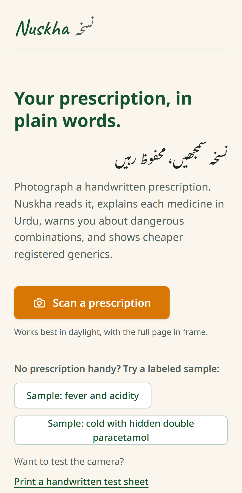
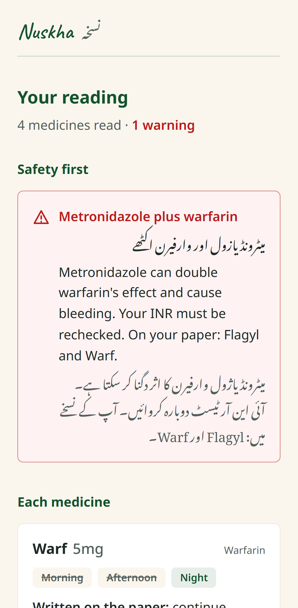
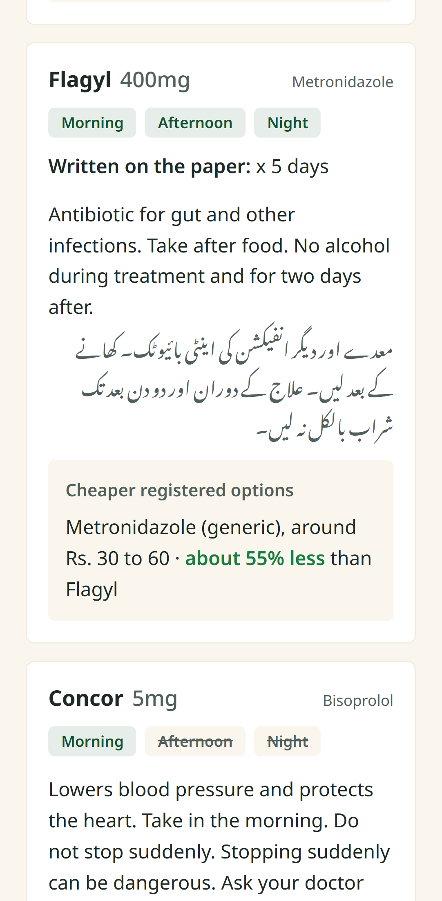
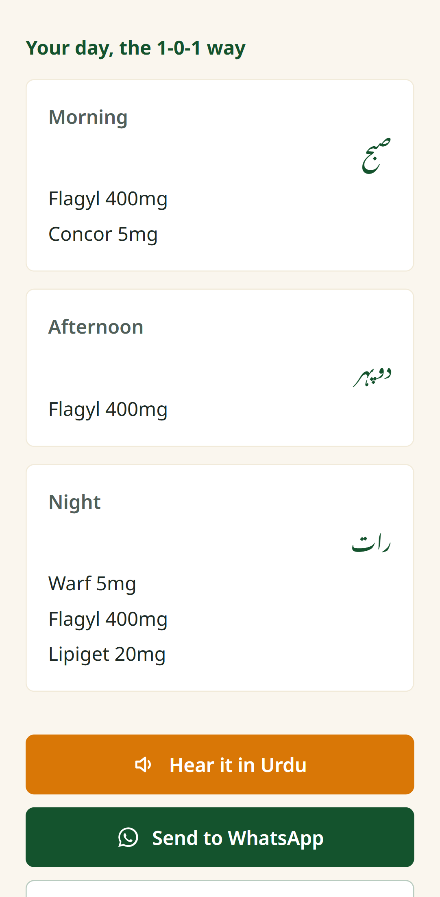

# Nuskha (نسخہ)

**Your prescription, in plain words.** Photograph a handwritten prescription. Nuskha reads every medicine on it, explains each one in Urdu and English (out loud too), warns you about dangerous combinations, shows cheaper registered generics, and turns the doctor's 1-0-1 marks into a daily schedule you can send to family on WhatsApp.

Built solo for the NYLP AI Hackathon 2026.

- Live app: _link added at deployment_
- Demo video: _Loom link_
- Try it without a prescription: open the app and tap a labeled sample, or print the [handwritten test sheets](public/sample-rx/printable.html) and photograph them with your phone.

<p>
  
  
  
  
</p>

The screenshots above come from a real reading of [handwritten sheet 3](public/sample-rx/rx-3.png), not from canned data.

## The problem

In Pakistan, the instructions for a medicine usually live on a handwritten slip. The patient has to decode three things from it:

1. **What each medicine is and how to take it.** The handwriting is hard to read, and the names are English brand names. The [Pakistan Economic Survey 2025-26](https://www.finance.gov.pk/survey/chapter_26/Highlights_of_the_PES_2026.pdf) puts national literacy at 63%, and 54% for women, who often manage medicines for the whole family.
2. **Whether two medicines clash.** A cold tablet like Panadol CF contains the same paracetamol as the Panadol written on the line above it, and together they can pass the safe daily limit. An antibiotic prescribed for diarrhoea can make an elderly parent's blood thinner dangerously strong. Nobody at the counter points this out.
3. **Whether a cheaper version exists.** Pakistan sells the same molecule under many brands at very different prices. Patients rarely know which registered generic matches their brand.

## The solution

| Step | What Nuskha does |
| --- | --- |
| Read | A vision model extracts each medicine name, strength, the 1-0-1 schedule, how many tablets each time, and any note written beside it, with a confidence level per name. |
| Match | Each name is matched to a curated list of medicines sold in Pakistan. The matcher strips prefixes like Tab and Syp, knows older brand names, and tolerates small misspellings. |
| Check | A deterministic safety engine flags duplicate ingredients and known dangerous pairs, and names the exact medicines from the user's paper. |
| Add up | Daily totals per ingredient (strength × tablets × doses, across every medicine), compared with the usual adult limit. Two paracetamol products that each look fine can add up to 4,500 mg a day; Nuskha shows the sum and flags it. |
| About you | An optional on-device profile: over 60, pregnant, kidney problems, penicillin allergy, aspirin intolerance. Warnings that apply only to that person appear straight away, and the paracetamol limit drops to 3,000 mg after 60. |
| Show where | The photo is shown with a numbered box around every line Nuskha read. Tapping a box jumps to that medicine, so the user can check each line against the paper. |
| Explain | Plain explanations in English and Urdu (Nastaliq script, right to left). They can be read aloud with the phone's Urdu voice, sentence by sentence. |
| Save money | Registered generic alternatives with approximate price ranges. |
| Remember | A morning, afternoon and night schedule, shareable to WhatsApp in one tap, and a calendar file with a reminder at each dose time. Courses written as "x 5 days" or "5/7" stop on their own. Recent readings are kept on the device only. |

**Safety is designed in, not bolted on:**

- The AI never decides whether something is dangerous. It only transcribes. Warnings come from fixed, reviewable rule sets in [`src/lib/safety.ts`](src/lib/safety.ts) and [`src/lib/review.ts`](src/lib/review.ts), so the same paper and profile always get the same warnings.
- Names read with low confidence show an amber hint asking the user to check against the medicine box.
- Medicines that are not in the local list are still shown, with a note to confirm with the pharmacist. Nothing silently disappears.
- Every screen built from sample data is labeled "Sample prescription", including the WhatsApp message.
- Every result ends with: "Nuskha explains your prescription. Your doctor and pharmacist make the decisions."

## Tech stack

| Layer | Choice |
| --- | --- |
| Framework | Next.js 16 (App Router, Turbopack), React 19, TypeScript |
| Styling and motion | Tailwind CSS v4, Framer Motion |
| Fonts | Noto Sans, Noto Nastaliq Urdu, Caveat (via `next/font/google`) |
| AI | Google Gemini API through `@google/genai`: `gemini-3.5-flash`, falling back to `gemini-3.5-flash-lite` |
| Voice | Browser Web Speech API (`ur-PK`), no paid TTS |
| Storage | `sessionStorage` for the open reading and its photo (this tab only), `localStorage` for history and the profile. No database, no accounts. |
| Hosting | Vercel |

### Project layout

```
src/
  app/
    page.tsx              Home: capture, samples, recent readings
    result/page.tsx       Result: profile, warnings, daily totals, photo boxes, cards, schedule, voice, WhatsApp, calendar
    api/analyze/route.ts  Gemini call, model fallback, error mapping, output sanitising
  lib/
    medicines-pk.ts       Curated Pakistani medicine list and the matcher
    safety.ts             Duplicate-ingredient and interaction rules
    review.ts             Daily dose totals and profile rules, re-run on every view
    profile.ts            On-device "About you" answers
    calendar.ts           Dose reminders as an .ics file, with course end dates
    analysis.ts           Builds a result from extracted medicines, plus labeled samples
    schedule.ts           1-0-1 schedule and WhatsApp text
    speech.ts             Urdu speech, sentence by sentence
    image.ts              On-device photo resizing before upload
    history.ts            On-device recent readings
public/sample-rx/         Printable handwritten test prescriptions with an answer key
```

## Setup

You need Node.js 20 or newer and a free Gemini API key from [Google AI Studio](https://aistudio.google.com/apikey).

```bash
git clone https://github.com/AHMEDALIGHORI/nuskha.git
cd nuskha
npm install
```

Create `.env.local` in the project root. It is git-ignored, so never commit it:

```bash
GEMINI_API_KEY=your_key_here
# Optional overrides
# GEMINI_MODEL=gemini-3.5-flash
# GEMINI_FALLBACK_MODEL=gemini-3.5-flash-lite
```

Then run:

```bash
npm run dev      # http://localhost:3000
npm run lint
npm run build && npm start
```

Without a key the app still runs. The labeled samples work, and photo reading shows a clear "not switched on yet" message.

To deploy on Vercel, import the repository and add `GEMINI_API_KEY` under Project Settings, Environment Variables.

## AI methodology

**1. On-device preparation.** The photo is decoded in the browser with its camera orientation respected. It is resized to at most 1600 px on the long side and re-encoded as JPEG. That keeps phone photos well under upload limits without losing handwriting detail.

**2. Structured extraction, not free text.** The server sends the image to Gemini with a strict JSON response schema and temperature 0.1. The prompt is specific to Pakistani prescriptions:

- schedules written as `1+0+1`, `1-0-1` or marks over three columns
- dosage-form prefixes (Tab, Cap, Syp, Inj, T.) removed from names
- advice lines, signatures, lab orders and follow-up notes ("INR check after 3 days") skipped
- best guess with lowered confidence when a word is unclear, and never an invented medicine
- tablets per dose (`2+0+2` means 2 each time) and a bounding box for each medicine's line, in Gemini's normalised 0 to 1000 coordinates
- an empty list when the photo is not a prescription

**3. Sanitising.** The model's output is treated as untrusted. Names and notes are trimmed and length-capped, every schedule is forced into three booleans, missing confidence defaults to medium, tablets per dose must be between a quarter and 4, boxes must be four in-range numbers in the right order, and at most 15 medicines are kept.

**4. Deterministic matching and safety.** From here on, no AI is involved:

- The matcher scores, in order: an exact brand or alias match, a whole-word brand inside the text, a partial match, a molecule name, and finally an edit-distance match for misspellings ("Glucophge" matches Glucophage).
- The safety engine compares matched ingredients across all medicines. It flags duplicates (paracetamol duplicates are always "danger") and molecule-level interaction pairs. Examples are aspirin plus warfarin, metronidazole plus warfarin, ibuprofen with blood pressure pills, pseudoephedrine cold medicine with blood pressure pills, and stacked sedatives.
- The dose check parses strengths like `500mg`, `1 g` or `250mcg`. For combination products it uses the per-tablet amounts stored in the dataset, because the number on the paper does not describe each ingredient. Syrups are skipped, since a volume cannot be added up reliably. Going over the paracetamol limit is "danger"; going over other limits is "caution", because doctors sometimes choose a higher dose on purpose.
- Profile rules follow product-label warnings (pregnancy, kidney function, penicillin allergy) and the AGS Beers Criteria for adults over 60. They run on the device every time a reading is opened, so past readings are re-checked when the profile changes.

**5. Resilience.** If the primary model is busy or unavailable (HTTP 404, 429, 500 or 503), the route retries once on the fallback model. Each failure type maps to a plain-language message, such as "the reader is busy" or "could not open that photo", with a Try again button.

**How it was tested.** Four handwritten test prescriptions, from easy to hard, are in [`public/sample-rx/`](public/sample-rx/printable.html) with an answer key. In local testing, the live reader extracted the names, strengths and schedules on all four, and produced the expected warnings: none on sheet 1, a paracetamol duplicate on sheet 2, metronidazole plus warfarin on sheet 3, and two cautions on sheet 4. Each reading took roughly 5 to 9 seconds. On sheet 3 the boxes landed on the right handwritten lines. The rule modules were also run against a scripted set of cases: strength parsing, course lengths, dose totals with and without the over-60 limit, a penicillin allergy, and calendar line folding. This is a small, hand-made test set. It shows the pipeline works end to end, not a measured accuracy rate.

## Data sources and limitations

- **Medicine list:** 38 medicines commonly dispensed in Pakistan, curated by hand. Brand names, molecules and forms come from public product information. Interaction rules follow standard pharmacology references and openFDA drug label interaction sections.
- **Checked against local listings.** In October 2026 every entry was compared with Pakistani online pharmacy listings. That review corrected Panadol CF (its decongestant is pseudoephedrine) and Arinac Forte (ibuprofen 400 mg with pseudoephedrine 60 mg, not a paracetamol product). It also moved four entries to the brands actually stocked locally (Warfin, Norvasc, Thyroxine, Aldactone-A) and updated Fefol to Fefol-Vit. The older names are kept as aliases, so they still match when a doctor writes them.
- **Dose limits** are the usual adult maximums from product labels. They are not personal dosing advice, and children's doses are not checked.
- **Prices are approximate.** Ranges are typical retail prices in PKR, compiled from public pharmacy listings. They are for awareness, not offers, and they change.
- **Not a medical device.** Nuskha explains and flags. It does not diagnose, change doses, or replace a doctor or pharmacist. Its warnings say "confirm with your doctor or pharmacist".
- **Coverage.** A medicine outside the list still appears, with a note to confirm it at the pharmacy. The interaction rules cover common, high-risk pairs, not every possible interaction.
- **Voice** depends on an Urdu voice being installed on the device. When it is missing, the app says so and explains how to add one on Android.
- **Privacy.** The photo is sent to the Gemini API to be read and is not stored by Nuskha. On the phone it stays only in the open tab, to draw the boxes; it is never saved in history. Results and the profile stay in the browser.

## From hackathon to startup

Nuskha is designed to run cheaply at scale: one fast vision call per prescription, with everything else deterministic and on-device. The plan beyond the hackathon:

1. **Pilot with pharmacies.** A counter tablet that reads a slip and prints an Urdu explanation for the customer. A pharmacy chain pays per store per month.
2. **Grow the medicine list** to the full DRAP-registered catalogue, with prices refreshed from distributor feeds. Pharmacist review of every safety rule.
3. **Telehealth and insurers.** An API for clinics and health insurers who need prescriptions digitised and checked for duplicates.
4. **Patients stay free.** Reading, warnings and schedules remain free for patients. Optional paid extras could include refill reminders and a family dashboard for parents' medicines.

## Disclosure of AI and third-party services

**At runtime:**

- **Google Gemini API** reads the photo. This is the only external API.
- **Browser Web Speech API** for Urdu voice.
- **WhatsApp click-to-chat links** (`wa.me`) for sharing.
- **Google Fonts** through `next/font`, self-hosted at build time.

**During development:** an AI coding assistant (Qoder) was used as an assistant for scaffolding, code suggestions, test scripts and QA automation. The product idea, the safety rules, the medicine list and the design decisions were reviewed and directed by the author. Design guidance came from the open-source [anti-slop](https://github.com/miqdadbadjuber/anti-slop) rules and the [UI/UX Pro Max](https://github.com/nextlevelbuilder/ui-ux-pro-max-skill) skill.

## Contributions

Solo project by [@AHMEDALIGHORI](https://github.com/AHMEDALIGHORI): idea, product design, implementation, the medicine list and safety rules, test prescriptions, and the demo.
